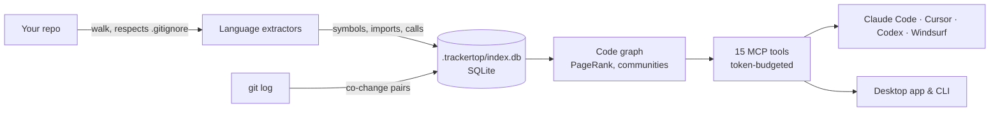

<div align="center">

# ⚡ TrackerTop

**A codebase knowledge graph for AI coding agents: it answers in surgical, token-budgeted context instead of whole files.**

[](https://github.com/trgtefecngz/TrackerTop/actions/workflows/ci.yml)
[](https://github.com/trgtefecngz/TrackerTop/releases/latest)
[](LICENSE)
[](Cargo.toml)
[](#mcp-tools)

[Install](#install) · [Connect your agent](#connect-your-ai-agent) · [How it works](#how-it-works) · [MCP tools](#mcp-tools) · [CLI](#cli) · [Safety](#safety--privacy) · [Roadmap](docs/ROADMAP.md)

</div>

---

AI coding agents spend most of their context window on `grep` loops and full-file reads. TrackerTop indexes your repository into a deterministic graph of files, symbols, calls, imports and git co-changes, and serves it to **Claude Code, Cursor, Codex CLI, Windsurf and any MCP client** as 15 small, token-budgeted tools.

- **Surgical context:** read one function plus its callers and callees, not a 3,000-line file.
- **Blast radius before you change code:** dependents, co-changing files and the tests to re-run.
- **Measured savings:** every answer is counted in real BPE tokens, per project and in total.
- **Offline and local:** a single Rust binary with a native desktop app. No account, no telemetry, no network.

## Token savings

Measured on a real 342-file, 443,561-token game repository (Rust, WGSL, HTML, TOML, Markdown):

| Operation | Raw reads | TrackerTop | Saved |
|---|---:|---:|---:|
| Architecture overview (`repo_map`) | 120,688 tok | **819 tok** | **99.3%** |
| Blast radius of the current diff (`diff_impact`) | 79,815 tok | **319 tok** | **99.6%** |
| Symbol-tagged search (`smart_grep`) | 11,690 tok | **135 tok** | **98.8%** |
| One symbol plus its neighbours (`read_symbol`) | 16,456 tok | **1,296 tok** | **92.1%** |

Repeated MCP calls reuse the in-memory graph: on a 361-file, 126k-line repo, a `find_symbol` call takes **~55 ms** instead of ~177 ms in v0.5.0.

---

## Install

**Windows (PowerShell)**
```powershell
irm https://raw.githubusercontent.com/trgtefecngz/TrackerTop/main/scripts/install.ps1 | iex
```
Downloads the latest release, verifies its SHA256, installs it to `%LOCALAPPDATA%\TrackerTop`, adds it to your user `PATH`, creates a desktop shortcut and starts the app.

**macOS / Linux**
```bash
curl -fsSL https://raw.githubusercontent.com/trgtefecngz/TrackerTop/main/scripts/install.sh | bash
```
Picks the right binary for Apple Silicon, Intel Mac or Linux x64, verifies its SHA256 and installs it to `~/.local/bin/trackertop`.

**Manual download:** every [release](https://github.com/trgtefecngz/TrackerTop/releases/latest) has these assets, each with a matching `.sha256` file:

| Platform | Asset |
|---|---|
| Windows x64 (also runs on Windows on ARM) | `TrackerTop-<version>-windows-x64.exe` |
| macOS Apple Silicon | `TrackerTop-<version>-macos-arm64` |
| macOS Intel | `TrackerTop-<version>-macos-x64` |
| Linux x64 (CLI + MCP, no GUI) | `trackertop-<version>-linux-x64-headless` |

**From source** (Rust 1.89+)
```bash
cargo install --git https://github.com/trgtefecngz/TrackerTop                       # with desktop app
cargo install --git https://github.com/trgtefecngz/TrackerTop --no-default-features # CLI + MCP only
```

## Connect your AI agent

**From the desktop app:** click **Connect AI Agents** and pick Claude Code, Cursor, Codex CLI or Windsurf, or copy the universal MCP JSON for any other client (VS Code, Zed, Cline, …).

**From the terminal:**
```bash
trackertop install claude --global   # Claude Code: user-level MCP server, skill, CLAUDE.md rules, SessionStart hook
trackertop install claude            # Claude Code: only this project (.mcp.json + project CLAUDE.md)
trackertop install cursor            # ~/.cursor/mcp.json
trackertop install codex             # ~/.codex/config.toml
trackertop install windsurf          # ~/.codeium/windsurf/mcp_config.json
```

**Any other MCP client:**
```json
{ "mcpServers": { "trackertop": { "command": "/path/to/trackertop", "args": ["mcp"] } } }
```

The installer only ever adds a `trackertop` entry. Your existing configuration is backed up and never overwritten (see [Safety](#safety--privacy)).

Then open any project folder in your agent. TrackerTop indexes it on the first tool call and keeps the index up to date incrementally.

---

## How it works



1. **Incremental indexing.** Only files whose size, mtime or content hash changed are re-parsed. Each query refreshes the index in milliseconds, so answers always match the code on disk.
2. **Graph.** Symbols and their relations (`calls`, `imports`, `uses type`, `tests`, `co-changes`) become a directed graph ranked with PageRank and grouped into module communities.
3. **Token budgets.** Every tool takes `max_tokens` and trims its answer on line boundaries, then reports how many tokens it sent compared to reading the files directly.
4. **One index, many processes.** The desktop app and several agent sessions can share the same index safely: writes are transactional, and long-running servers notice when another process re-indexed.

## MCP tools

| Tool | What it returns |
|---|---|
| `repo_map` | Architecture overview: languages, the most central symbols, module clusters and saved project notes |
| `task_context` | Best first call for a task: the code of the most relevant symbols plus 1-hop dependency signatures, within budget |
| `smart_grep` | Text search where every hit is tagged with its enclosing function, struct or shader |
| `file_outline` | Signatures and line ranges of a file instead of its full text |
| `read_symbol` | Exact source of one symbol plus caller/callee signatures and attached notes |
| `read_symbols_batch` | Several symbols in one round trip with a shared budget |
| `find_symbol` | Lexical + PageRank symbol search across all languages |
| `call_graph` | Callers and callees around a symbol, up to N hops |
| `impact_analysis` | Direct and transitive dependents of a symbol, affected files and linked tests |
| `diff_impact` | Blast radius of your uncommitted changes (or the last commit): dependents, co-changing files, tests to re-run |
| `health_check` | Token-bloated files, circular dependencies and likely orphan files |
| `shortest_path` | Shortest dependency path between two symbols or files |
| `remember` / `recall` | Persistent architectural notes, surfaced automatically in later sessions |
| `token_stats` | Cumulative tokens saved and estimated cost reduction |

## Supported languages

| Language | Extensions | Extraction |
|---|---|---|
| **Rust** | `.rs` | Tree-sitter AST: modules, `use`, structs, enums, traits, impls, functions, `#[test]`, calls, type references, Rust ↔ WGSL/HTML/TOML asset links |
| **TypeScript / JavaScript** | `.ts` `.tsx` `.js` `.jsx` `.mjs` `.cjs` | Imports/`require`, classes, methods, interfaces, types, enums, arrow functions, `it`/`test` blocks, calls |
| **Python** | `.py` `.pyi` | Imports, classes and inheritance, functions and methods, `test_*`, docstrings, calls |
| **Go** | `.go` | Imports, structs, interfaces, receiver methods, `Test*`, calls |
| **HTML** | `.html` `.htm` | Tree-sitter AST: assets and links, ids, `<canvas>`, `<template>`, custom elements, inline scripts and shader fetches |
| **WGSL** | `.wgsl` | Entry points, `@group`/`@binding` resources, structs, functions, `#import`, calls |
| **PowerShell** | `.ps1` `.psm1` `.psd1` | Functions, filters, classes, enums, `param(...)`, `Import-Module`, dot-sourcing, calls |
| **Markdown, TOML** | `.md` `.toml` | Headings, backtick symbol references, Cargo dependencies |

Adding a language takes one `LanguageExtractor` implementation and no changes to the graph, MCP server or UI: see [docs/ADDING_LANGUAGES.md](docs/ADDING_LANGUAGES.md).

## CLI

Every command works on the current directory, or on `--repo <path>`.

| Command | Description |
|---|---|
| `trackertop` / `trackertop ui` | Open the desktop app |
| `trackertop index [--force]` | Index (incrementally, or fully with `--force`) |
| `trackertop query <action>` | Run a tool from the terminal: `map`, `outline`, `symbol`, `find`, `calls`, `impact`, `pack`, `path`, `grep`, `diff`, `health` |
| `trackertop stats [--reset]` | Token savings for this project |
| `trackertop projects` | All tracked projects and total savings |
| `trackertop report` | Write a Markdown summary to `.trackertop/GRAPH_REPORT.md` |
| `trackertop languages` | List the registered language extractors |
| `trackertop install <agent> [--global]` | Connect an agent (see above) |
| `trackertop mcp` | Run the MCP server over stdio (agents start this for you) |

---

## Safety & privacy

- **Fully offline.** TrackerTop never opens a network connection. Your code and statistics stay on your machine.
- **Your configs are never clobbered.**
  - A config that cannot be parsed (for example JSON with comments) is left untouched, and the installer stops with a message.
  - Before the first change, the original is saved as `<file>.trackertop.bak`. That first backup is kept and never overwritten.
  - Writes are atomic and keep the file's permissions and symlinks.
- **It stays out of places that are not projects.** Indexing is refused for your home folder, a drive root, and a bare Desktop, Downloads or Documents folder (projects inside them are fine). This matters when an agent is started from your home directory.
- **It stays out of your git history.** The per-project cache `.trackertop/` writes its own `.gitignore`.
- **Verified downloads.** The installers check each release binary against its published SHA256. This catches corrupted or truncated downloads; it does not protect against a compromised GitHub account.

### Where data lives

| Path | Contents |
|---|---|
| `<project>/.trackertop/index.db` | The project's index and token statistics (SQLite) |
| `~/.trackertop/projects.json` | The list of tracked projects shown in the desktop app |
| `<config>.trackertop.bak` | The original copy of an agent config TrackerTop modified |

To remove a project, use **Remove** in the desktop app (**Shift+click** also deletes its `.trackertop/` cache), or delete that folder yourself.

## Troubleshooting

| Symptom | Fix |
|---|---|
| *"TrackerTop refuses to index `C:\Users\you` because it is your home directory"* | Open your agent inside a project folder, or pass `--repo <project>`. |
| *"… is not plain JSON (comments or trailing commas?)"* during install | Remove the comments or trailing commas from that file, or add the `trackertop` MCP entry by hand. Nothing was changed. |
| The installer cannot replace `TrackerTop.exe` | Close the TrackerTop app and every agent session using it, then run the installer again. |
| Results look stale | Run `trackertop index --force`. |

## Development

```bash
cargo build                                          # desktop app + CLI
cargo build --no-default-features                    # CLI + MCP only
cargo test
cargo clippy --all-targets -- -D warnings
cargo fmt --check
```

CI runs formatting, clippy (with warnings as errors), the full test suite on Windows and Linux, and ShellCheck for the installer. See [CONTRIBUTING.md](CONTRIBUTING.md), [CHANGELOG.md](CHANGELOG.md) and the [roadmap](docs/ROADMAP.md).

## License

[MIT](LICENSE)
